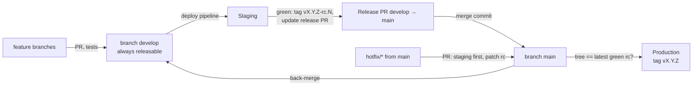
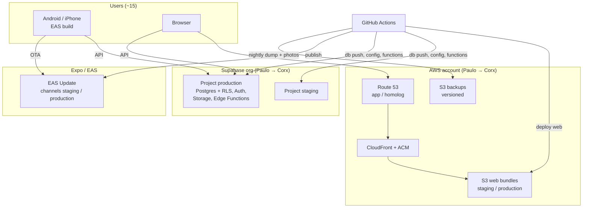

# Architecture Spine — Cloud deployment

## Design Paradigm

**Managed BaaS + static frontend, GitOps promotion.** Supabase Cloud is the whole backend; everything
the user downloads (web bundle, mobile binaries, OTA updates) is a static artifact built in CI. Git is
the only way state reaches an environment: `develop` → staging, `main` → production.

| Layer | Runs on | Source in repo |
| --- | --- | --- |
| Data, access rules, auth, files, server logic | Supabase Cloud (São Paulo) | `supabase/migrations`, `supabase/config.toml`, `supabase/functions` |
| Web app | AWS S3 + CloudFront, DNS in Route 53, TLS from ACM | `apps/mobile` (`expo export --platform web`) |
| Mobile app | EAS Build (binaries) + EAS Update (JS) | `apps/mobile`, `eas.json` |
| Pipeline | GitHub Actions | `.github/workflows` |
| Off-platform backups | AWS S3 | `.github/workflows` (scheduled) |
| AWS resources | as code | `infra/` |

## Invariants & Rules



### AD-1 — Hybrid hosting split [ADOPTED]

- **Binds:** all
- **Prevents:** backend responsibilities leaking into AWS-native services (photos written straight to S3, auth in Cognito, logic in Lambda), which would split access control away from RLS.
- **Rule:** Postgres, Auth, Storage and server-side logic live only in Supabase (Edge Functions or database functions). AWS hosts only the static web bundle, DNS, TLS certificates and backup copies. A new server-side need is an Edge Function or a database function, never an AWS compute service.

### AD-2 — Two cloud environments, isolated [ADOPTED]

- **Binds:** all
- **Prevents:** migrations or test data hitting production first; one environment's keys working against the other.
- **Rule:** staging and production each have their own Supabase project, S3 bucket, CloudFront distribution, EAS environment and Update channel, and GitHub Environment holding its secrets. Nothing is shared between them except the AWS account, the Supabase organization and the Expo project. Local Docker remains the development environment and is never deployed to.

### AD-3 — Git branch decides the environment; production ships exactly what staging ran [ADOPTED]

- **Binds:** CI/CD, every deployable artifact
- **Prevents:** production receiving code that never ran in staging, hotfixes included; a release PR changing under review; a hotfix lost because it never reached `develop`; manual deploys from a laptop.
- **Rule:**
  - Work reaches `develop` only by PR from a feature branch, with tests green.
  - A push to `develop` runs the deploy pipeline (AD-5) on staging; only when it succeeds does CI tag `vX.Y.Z-rc.N` and open or update the release PR `develop` → `main`.
  - Hotfix: a `hotfix/*` branch cut from `main`. Opening its PR to `main` runs the pipeline on staging from the hotfix branch and tags a patch rc (`vX.Y.Z+1-rc.N`); after merging into `main`, `main` is merged back into `develop` right away, which redeploys staging with `develop`.
  - `main` accepts merges only from `develop` or `hotfix/*`, as merge commits (squash and rebase disabled); after each hotfix back-merge, `main` is again an ancestor of `develop`.
  - The production workflow deploys only if the tree of the `main` commit equals the tree of the newest `rc` tag and that tag's staging run succeeded; otherwise it fails without deploying. On success it tags `vX.Y.Z`.
  - No deploy runs outside GitHub Actions.

### AD-4 — Version derived from commit messages, never committed

- **Binds:** CI/CD, release tags, app version
- **Prevents:** two releases picking the same version; version-bump commits re-triggering pipelines or making `main` drift from `develop`; rc tags racing.
- **Rule:** commits follow Conventional Commits (already in use). The next version comes from commits since the latest tag matching `vX.Y.Z` exactly (rc tags never count as a release): `feat` → minor, `fix`/other → patch, `!` → major. The rc number is computed inside the serialized staging deploy (AD-5). The version is injected at build time through `app.config.ts` from the pipeline; no workflow commits to the repo.

### AD-5 — One ordered deploy pipeline per environment; backend config only through it

- **Binds:** database, auth settings, storage buckets, Edge Functions, web, OTA
- **Prevents:** a function or client deploying before the schema it needs; web/OTA shipping after a failed migration; two deploys of one environment overlapping; dashboard edits drifting staging from production; local values pushed to the cloud.
- **Rule:**
  - Steps run in this order and stop at the first failure: tests → `supabase link` → `supabase db push --remote --yes` → `supabase config push --remote --yes` → `supabase functions deploy --remote --use-api` → web build + S3 sync + CloudFront invalidation → `eas update` → tag. The CLI is installed with `supabase/setup-cli@v3` pinned to the repo's CLI version; deprecated flags (`--project-ref`, `--linked`, `--db-url`) are not used.
  - Each environment has one concurrency group; a running deploy is never cancelled, a newer one queues.
  - Schema, RLS, storage buckets and their policies are defined only in `supabase/migrations` (never under `[storage.buckets.*]` in `config.toml`). Migrations are forward-only: a fix is a new migration.
  - Every per-environment value in `supabase/config.toml` (site URL, redirect URLs, secrets) uses `env()`; local defaults live in a committed `supabase/.env` with no real secrets. The pipeline shows the `config push` diff in the job log before applying.
  - The Supabase dashboard is read-only in practice; a scheduled job compares each cloud project's schema with the migrations and fails loudly on drift.

### AD-6 — Configuration through environment variables, one owner per target

- **Binds:** `apps/mobile`, Edge Functions, CI
- **Prevents:** an environment URL or key hard-coded in source; a staging URL baked into a production web bundle or OTA update; secrets in the bundle.
- **Rule:**
  - The app reads its backend only from `EXPO_PUBLIC_SUPABASE_URL` and `EXPO_PUBLIC_SUPABASE_KEY` (publishable key).
  - Web: values come from the GitHub Environment. Mobile: values come only from the EAS environment (`staging`, `production`); each `eas.json` build profile sets its `environment` and `channel` and carries no `EXPO_PUBLIC_*` values; updates always run as `eas update --channel <env> --environment <env> --non-interactive`. An update is never republished from one environment's channel to the other's.
  - After building, CI checks that the bundle contains the target environment's project ref and not the other's.
  - Secret keys (service role, DB password, Supabase access token, Storage S3 keys) live only in GitHub Environment secrets and Supabase function secrets. AWS access from CI uses GitHub OIDC with one role per environment, no long-lived AWS keys; each role's trust policy matches the `sub` claim exactly as GitHub issues it for this repo (printed once from a workflow before writing `infra/`, since newer repos use the ID-based format).

### AD-7 — Test data never reaches production [ADOPTED]

- **Binds:** `supabase/seed.sql`, `scripts/create-dev-users.mjs`, CI
- **Prevents:** the shared test password (`buildops123`) opening production.
- **Rule:** `seed.sql` and the test users run only locally and in staging; in staging an idempotent staging-only job applies them (`db push` never seeds). Production keeps public sign-up disabled (`enable_signup = false`); its first director is created once by hand, and every other account is created by a director through the user-management screen.

### AD-8 — Mobile releases: binaries rarely, OTA often

- **Binds:** `apps/mobile`, `eas.json`
- **Prevents:** an OTA update reaching a binary that lacks its native code; every release changing the runtime version so no OTA ever applies.
- **Rule:** staging and production apps are EAS builds, not Expo Go (Expo Go is development-only). `runtimeVersion` uses the `fingerprint` policy, configured so the app version (AD-4) does not enter the fingerprint. A JS-only change ships as an EAS Update on the environment's channel; a change that alters the fingerprint needs a new EAS build first: the pipeline computes the fingerprint and fails the `eas update` step when no build with that runtime version exists on the channel. Pilot distribution: Android internal APK or Play internal testing, iOS TestFlight; public store listings come later.

### AD-9 — Off-platform backups in AWS, with a restore target

- **Binds:** production data and photos
- **Prevents:** losing data if the Supabase project or account is lost, or during the account transfer; the backup silently stopping behind a deploy approval.
- **Rule:** besides Supabase's daily backups, a nightly workflow in its own GitHub Environment (`backup`, no reviewers) runs `supabase db dump` against production with a read-only database role through the session-mode pooler (port 5432; the direct host is IPv6-only and GitHub runners are IPv4-only), and syncs the photo bucket through Supabase's S3-compatible endpoint with Storage S3 keys held only in the `backup` environment, into a private, versioned S3 bucket with a retention lifecycle. This sync is the only backup of photos: Supabase's daily backups do not include Storage objects. A failed run alerts by email. Targets: lose at most 24 h of data (RPO), back in service within one business day (RTO); these are a cost trade-off to present to Corx, and tighter targets mean higher spend (Supabase point-in-time recovery, more frequent dumps). A restore into staging is rehearsed before go-live and after every account transfer.

### AD-10 — Accounts start personal, end with Corx

- **Binds:** GitHub repository, Supabase organization, AWS account, Expo account, Apple and Google developer accounts, domain, app identifiers
- **Prevents:** the group's data, code and app listings being stuck in an individual's accounts; CI breaking silently after a transfer.
- **Rule:** all accounts start in Paulo's name, owned at organization level (GitHub org or a repo ready to transfer, Supabase org, Expo org, a dedicated AWS account), never mixed with personal projects. The bundle/package id is fixed before the first store build and never changes. The transfer is a planned release task with a checklist: re-point the AWS OIDC trust to the new repo owner, rotate every secret, re-invite TestFlight testers, rehearse a restore (AD-9). After it, the ADOPTED principle "group-owned data" from `docs/architecture.md` holds again.

### AD-11 — Schema stays compatible with the previous release

- **Binds:** `supabase/migrations`, app data access, Edge Functions
- **Prevents:** a migration applied in seconds breaking phones that load the new JS only on their next cold start, and open web tabs.
- **Rule:** every migration must work with the JS of the previous production release (expand → migrate → contract). Drops, renames and type changes of anything the app calls ship one release later, once the minimum supported app version (a value the app reads at startup, asking the user to update when below it) has passed the release that stopped using them. CI flags destructive SQL in a migration that lacks a `-- contract: safe-after vX.Y.Z` note.

### AD-12 — Rollback by redeploying a tag

- **Binds:** CI/CD
- **Prevents:** improvised production fixes under pressure.
- **Rule:** rollback means re-running the production workflow for an earlier `vX.Y.Z` tag (web, functions, `eas update` republish), skipping `db push`; the database is never rolled back, only fixed forward with a new migration (AD-5, AD-11). Web deploys keep the previous release's hashed assets so open tabs don't break.

## Consistency Conventions

| Concern | Convention |
| --- | --- |
| Environment names | `local`, `staging`, `production`, `backup` (GitHub Environment) in code, config and CI; "homologação" only in pt-BR UI and Corx docs |
| Hostnames | `app.<domain>` production web, `homolog.<domain>` staging web |
| Release tags | `vX.Y.Z-rc.N` on staging, `vX.Y.Z` on production |
| Secrets naming | `SUPABASE_ACCESS_TOKEN`, `SUPABASE_PROJECT_REF`, `SUPABASE_DB_PASSWORD`, `AWS_ROLE_ARN`, `WEB_BUCKET`, `CLOUDFRONT_DISTRIBUTION_ID`, `EXPO_TOKEN`; public vars `EXPO_PUBLIC_SUPABASE_URL`, `EXPO_PUBLIC_SUPABASE_KEY` |
| Web routing and caching | single-page app: `web.output: "single"` stays explicit in app config (SDK 58 defaults to `server`, which S3 can't host); CloudFront maps 403/404 from the S3 origin to `/index.html` with status 200; hashed assets cached long, `index.html` not cached |
| Edge Function CORS | allowed origins are the environment's web hostnames (from a function secret), not `*`; JWT verification stays on |
| Cost | AWS Budgets alarm and Supabase spend cap per organization, alerting by email |

## Stack

| Name | Version |
| --- | --- |
| Supabase Cloud, plan Pro, region São Paulo (sa-east-1) | Postgres 17 |
| Supabase CLI | 3.x (repo `^3.2.0`) |
| Expo SDK / EAS Build / EAS Update | 58 |
| AWS S3 + CloudFront + Route 53 + ACM | managed |
| GitHub Actions | managed |
| Node (CI pins 24; `engines.node` raised to match Expo SDK 58: 22.13+ / 24.3+) / pnpm | 24 / 12.18.0 |
| `supabase/setup-cli` GitHub Action | v3 |

## Structural Seed



```text
.github/workflows/
  ci.yml            # tests on every PR
  deploy.yml        # ordered pipeline (AD-5), called for staging (develop) and production (main)
  backup.yml        # nightly pg_dump + photo sync to S3 (AD-9)
  drift.yml         # scheduled schema drift check (AD-5)
apps/mobile/app.config.ts  # version and runtime config injected at build time
apps/mobile/eas.json       # build profiles and channels per environment
supabase/.env              # local defaults for env() in config.toml, no secrets
infra/                     # AWS resources as code (S3, CloudFront, Route 53, OIDC roles, budgets)
```

## Open Questions

- **`env()` in `config push`** — not confirmed by Supabase docs, and open issues report `env()` not expanding in arrays (`additional_redirect_urls`). First build task is a dry-run `config push` against staging; if it fails, per-environment values move to `[remotes.<env>]` overrides in `config.toml`, keeping AD-5's single owner.
- **Bundle/package id** — `com.buildops.app` is used for development and internal builds only; the final id (e.g. a Corx namespace) is a Corx decision, settled before the first store build (AD-10).

## Items for Corx

To present as cost vs decision: the backup targets (AD-9: 24 h RPO, one business day RTO, and what tighter targets would cost); the final app id in the stores; the domain; the account transfer (AD-10); the monthly cost of two Supabase projects plus AWS.

## Deferred

- **Domain name** — open question; hostnames use `<domain>` until it is chosen. Blocks only DNS/TLS setup.
- **Infrastructure-as-code tool for `infra/`** (CloudFormation, CDK or Terraform) — single owner, a handful of resources; pick at build time, as long as all AWS resources live in `infra/`.
- **Supabase compute size** — Micro for both projects at ~15 users and ~1 GB/month of photos; resize when CPU or connections demand it.
- **Error monitoring and uptime checks** (Sentry or similar) — Supabase logs and the alerts above cover the pilot; revisit before broader rollout.
- **Transactional email (Amazon SES as Supabase SMTP)** — the app sends no email today; needed only if password reset by email or invitations are added.
- **Production master data at go-live** (companies, cost centers, sites, materials) — depends on Stage 0; loaded through the app's master-data screens or an `import` job, never through `seed.sql`.
- **Public store listings** — after the pilot.
- **Full self-hosting on AWS** — rejected for now; revisit if Corx formally requires data inside its own AWS account, or Supabase cost/limits outgrow the hybrid.
- **Integrations with legacy systems (Stage 0)** — where those jobs run is decided with Stage 0, within AD-1.
